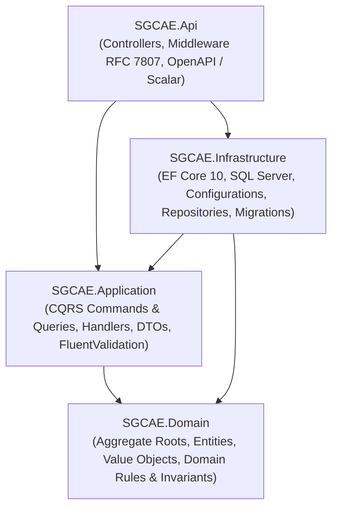
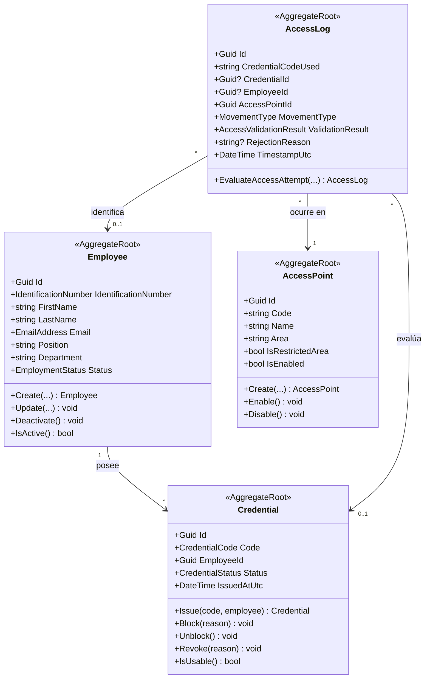

# Sistema de Gestión y Control de Acceso de Empleados (SGCAE)


Backend empresarial desarrollado en **ASP.NET Core Web API (.NET 10)** y **SQL Server** para centralizar la administración de empleados, el control del ciclo de vida de sus credenciales físicas/digitales, el registro trazable de entradas y salidas (autorizadas y rechazadas), y la auditoría paginada del historial de accesos en áreas operativas y restringidas.

---

## 1. Contexto del Caso de Estudio

Una empresa dedicada a la prestación de servicios logísticos y de almacenamiento registraba el ingreso y salida de su personal mediante planillas físicas y hojas de cálculo administradas manualmente por seguridad. Esto ocasionaba:
- Registros duplicados e inconsistentes.
- Dificultad para verificar la identidad y vigencia de las credenciales.
- Falta de trazabilidad en áreas restringidas y bodegas.
- Ausencia de mecanismos automáticos para impedir el ingreso de empleados cuyo vínculo laboral se encuentra inactivo.

El **SGCAE** resuelve esta problemática exponiendo una API REST centralizada bajo principios de **Clean Architecture**, **Domain-Driven Design (DDD)** y **Command Query Responsibility Segregation (CQRS)**.

---

## 2. Arquitectura de la Solución (Clean Architecture)

La solución está dividida en cuatro capas con dependencias estrictamente dirigidas hacia el núcleo del dominio:



### Estructura del Repositorio

```text
SGCAE.sln
├── src/
│   ├── SGCAE.Domain/                 # Núcleo de negocio sin dependencias externas
│   │   ├── Common/                   # Entity, AggregateRoot, ValueObject, DomainException, PagedResult
│   │   ├── Entities/                 # Employee, Credential, AccessPoint, AccessLog
│   │   ├── Enums/                    # EmploymentStatus, CredentialStatus, MovementType, AccessValidationResult
│   │   ├── Repositories/             # Contratos IEmployeeRepository, ICredentialRepository, IAccessPointRepository, IAccessLogRepository, IUnitOfWork
│   │   └── ValueObjects/             # IdentificationNumber, EmailAddress, CredentialCode
│   ├── SGCAE.Application/            # Casos de uso mediante CQRS y validación de entrada
│   │   ├── Common/                   # ICommand, IQuery, ValidationBehavior, Excepciones de Aplicación
│   │   └── Features/                 # Vertical Slices: Employees, Credentials, AccessPoints, AccessControl
│   ├── SGCAE.Infrastructure/         # Persistencia relacional con Entity Framework Core 10 y SQL Server
│   │   └── Persistence/              # ApplicationDbContext, Fluent API Configurations, Repositories, Migrations, Seed Data
│   └── SGCAE.Api/                    # Exposición de servicios REST, manejo global de errores y documentación OpenAPI
│       ├── Controllers/              # EmployeesController, CredentialsController, AccessPointsController, AccessControlController
│       ├── Middleware/               # GlobalExceptionHandler (ProblemDetails RFC 7807)
│       └── SGCAE.Api.http            # Suite verificable de peticiones HTTP para todos los requerimientos
└── tests/
    ├── SGCAE.Domain.UnitTests/       # 28 pruebas unitarias de entidades, objetos de valor e invariantes de dominio
    └── SGCAE.Application.UnitTests/  # 17 pruebas unitarias de casos de uso CQRS y validadores
```

---

## 3. Modelado del Dominio (DDD)



### Objetos de Valor (`Value Objects`)
- **`IdentificationNumber`**: Garantiza documento único normalizado en mayúsculas (3–30 caracteres alfanuméricos/guiones).
- **`EmailAddress`**: Normaliza en minúsculas y valida estructura de correo electrónico.
- **`CredentialCode`**: Garantiza formato estandarizado para tarjetas RFID/tokens de acceso (4–64 caracteres).

### Reglas de Negocio e Invariantes Encapsuladas
1. **Vínculo laboral requerido para emisión**: No es posible emitir una credencial a un empleado cuyo estado laboral sea `Inactive` o `Suspended`.
2. **Credencial única vigente por empleado**: Un empleado activo solo puede tener una credencial en estado `Active` simultáneamente.
3. **Irreversibilidad de revocación**: Una credencial en estado `Revoked` no puede ser bloqueada ni reactivada bajo ninguna circunstancia.
4. **Revocación automática por desvinculación**: Al desactivar a un empleado (`DeactivateEmployeeCommand`), sus credenciales vigentes o bloqueadas pasan automáticamente a estado `Revoked`.
5. **Trazabilidad inmutable de accesos (RF-03)**: Todo intento de entrada o salida genera un registro en `AccessLogs`, tanto si es `Authorized` como si es `Rejected`, almacenando la causal exacta del rechazo:
   - Punto de acceso deshabilitado.
   - Credencial no registrada en el sistema.
   - Credencial revocada definitivamente.
   - Credencial bloqueada temporalmente.
   - Empleado con vínculo laboral inactivo.

---

## 4. Implementación CQRS y Endpoints REST

| Req. | Funcionalidad | Tipo CQRS | Caso de Uso (`Application`) | Endpoint HTTP (`SGCAE.Api`) |
| :--- | :--- | :--- | :--- | :--- |
| **RF-01** | Registrar empleado | **Command** | `CreateEmployeeCommand` | `POST /api/v1/employees` |
| **RF-01** | Consultar empleados | **Query** | `GetEmployeesQuery` | `GET /api/v1/employees?status=&searchTerm=` |
| **RF-01** | Consultar empleado por ID | **Query** | `GetEmployeeByIdQuery` | `GET /api/v1/employees/{id}` |
| **RF-01** | Actualizar empleado | **Command** | `UpdateEmployeeCommand` | `PUT /api/v1/employees/{id}` |
| **RF-01** | Desactivar empleado | **Command** | `DeactivateEmployeeCommand` | `PATCH /api/v1/employees/{id}/deactivate` |
| **RF-02** | Asignar credencial | **Command** | `AssignCredentialCommand` | `POST /api/v1/credentials/assign` |
| **RF-02** | Consultar estado de credencial | **Query** | `GetCredentialByCodeQuery` | `GET /api/v1/credentials/{code}` |
| **RF-02** | Consultar credenciales por empleado | **Query** | `GetCredentialsByEmployeeQuery` | `GET /api/v1/employees/{id}/credentials` |
| **RF-02** | Bloquear credencial | **Command** | `BlockCredentialCommand` | `PATCH /api/v1/credentials/{code}/block` |
| **RF-02** | Desbloquear credencial | **Command** | `UnblockCredentialCommand` | `PATCH /api/v1/credentials/{code}/unblock` |
| **RF-02** | Revocar credencial | **Command** | `RevokeCredentialCommand` | `PATCH /api/v1/credentials/{code}/revoke` |
| **RF-03** | Registrar entrada o salida | **Command** | `RegisterAccessMovementCommand` | `POST /api/v1/access-control/movements` |
| **RF-04** | Consultar historial paginado | **Query** | `GetAccessHistoryQuery` | `GET /api/v1/access-control/history` |
| **RF-06** | Registrar punto de acceso | **Command** | `CreateAccessPointCommand` | `POST /api/v1/access-points` |
| **RF-06** | Consultar puntos de acceso | **Query** | `GetAccessPointsQuery` | `GET /api/v1/access-points?isEnabled=` |
| **RF-06** | Habilitar / Deshabilitar punto | **Command** | `ChangeAccessPointStatusCommand` | `PATCH /api/v1/access-points/{id}/status` |

---

## 5. Requisitos Previos y Ejecución

### Requisitos
- **.NET 10 SDK** (`10.0.x`)
- **SQL Server** (Local, Developer, Express o LocalDB)

### Configuración de Base de Datos
En `src/SGCAE.Api/appsettings.json` se encuentra configurada la cadena de conexión hacia SQL Server local:

```json
"ConnectionStrings": {
  "DefaultConnection": "Server=localhost;Database=SGCAE_Db;Trusted_Connection=True;TrustServerCertificate=True;MultipleActiveResultSets=true"
}
```
*(Si utilizas SQL Server LocalDB, puedes cambiar `Server=localhost` por `Server=(localdb)\\MSSQLLocalDB`).*

### Comandos para Compilar y Ejecutar

```bash
# 1. Restaurar y compilar la solución
dotnet build SGCAE.sln

# 2. Ejecutar las 45 pruebas unitarias (Dominio y Aplicación)
dotnet test SGCAE.sln

# 3. Iniciar el servidor Web API (Aplica migraciones EF Core y Datos Semilla automáticamente)
dotnet run --project src/SGCAE.Api/SGCAE.Api.csproj
```

Una vez iniciada la API:
- **Swagger UI (Documentación Interactiva)**: `http://localhost:5158/swagger`
- **Scalar UI (Documentación Alternativa)**: `http://localhost:5158/scalar/v1`
- **Especificación OpenAPI JSON**: `http://localhost:5158/openapi/v1.json`

---

## 6. Datos Semilla Incluidos (Seed Data)

Al arrancar por primera vez, `DatabaseInitializer` aplica las migraciones en SQL Server y crea datos iniciales listos para pruebas inmediatas:

- **Puntos de Acceso (RF-06)**:
  - `AP-REC-01`: Recepción Principal (`Habilitado`)
  - `AP-PAR-01`: Parqueadero Corporativo (`Habilitado`)
  - `AP-BOD-01`: Bodega Central de Almacenamiento (`Habilitado`, Área restringida)
  - `AP-RES-01`: Área Restringida - Cuarto de Servidores (`Habilitado`, Área restringida)
  - `AP-BOD-02`: Muelle de Carga Secundario (`Deshabilitado` por mantenimiento)
- **Empleados y Credenciales (RF-01 / RF-02)**:
  - **Carlos Andrés Martínez** (`1020304050`) — Estado `Active`, Credencial `CRD-2026-0001` (`Active`).
  - **Laura Valentina Ríos** (`1098765432`) — Estado `Active`, Credencial `CRD-2026-0002` (`Active`).
  - **Jorge Eduardo Pineda** (`1055667788`) — Estado `Inactive`, Credencial `CRD-2026-0003` (para verificar rechazo de acceso por vínculo laboral inactivo).

---

## 7. Evidencias Verificables de Funcionamiento

El archivo [`src/SGCAE.Api/SGCAE.Api.http`](src/SGCAE.Api/SGCAE.Api.http) incluye peticiones listas para probar cada caso de uso desde Visual Studio o VS Code.

### Ejemplo 1: Acceso Autorizado (`POST /api/v1/access-control/movements`)
**Request:**
```json
{
  "credentialCode": "CRD-2026-0001",
  "accessPointId": "3f9a1b20-...",
  "movementType": "Entry"
}
```
**Response (`200 OK`):**
```json
{
  "id": "8e44c912-...",
  "credentialCodeUsed": "CRD-2026-0001",
  "employeeFullName": "Carlos Andrés Martínez Gómez",
  "employeeIdentification": "1020304050",
  "accessPointCode": "AP-REC-01",
  "accessPointName": "Recepción Principal",
  "movementType": "Entry",
  "validationResult": "Authorized",
  "isAuthorized": true,
  "rejectionReason": null,
  "timestampUtc": "2026-10-29T20:29:23.412Z"
}
```

### Ejemplo 2: Acceso Rechazado por Vínculo Laboral Inactivo (`POST /api/v1/access-control/movements`)
**Request:**
```json
{
  "credentialCode": "CRD-2026-0003",
  "accessPointId": "3f9a1b20-...",
  "movementType": "Entry"
}
```
**Response (`200 OK` - Intento registrado en el historial de auditoría como rechazado):**
```json
{
  "id": "c190a480-...",
  "credentialCodeUsed": "CRD-2026-0003",
  "employeeFullName": "Jorge Eduardo Pineda Soto",
  "employeeIdentification": "1055667788",
  "accessPointCode": "AP-REC-01",
  "accessPointName": "Recepción Principal",
  "movementType": "Entry",
  "validationResult": "Rejected",
  "isAuthorized": false,
  "rejectionReason": "Vínculo laboral del empleado no activo (Estado: Inactive).",
  "timestampUtc": "2026-10-29T20:29:24.105Z"
}
```

### Ejemplo 3: Consulta Paginada del Historial (`GET /api/v1/access-control/history?validationResult=Rejected&pageNumber=1&pageSize=5`)
**Response (`200 OK`):**
```json
{
  "items": [
    {
      "credentialCodeUsed": "CRD-2026-0003",
      "employeeFullName": "Jorge Eduardo Pineda Soto",
      "accessPointCode": "AP-REC-01",
      "movementType": "Entry",
      "validationResult": "Rejected",
      "isAuthorized": false,
      "rejectionReason": "Vínculo laboral del empleado no activo (Estado: Inactive).",
      "timestampUtc": "2026-10-29T20:29:24.105Z"
    }
  ],
  "pageNumber": 1,
  "pageSize": 5,
  "totalCount": 7,
  "totalPages": 2,
  "hasPreviousPage": false,
  "hasNextPage": true
}
```

